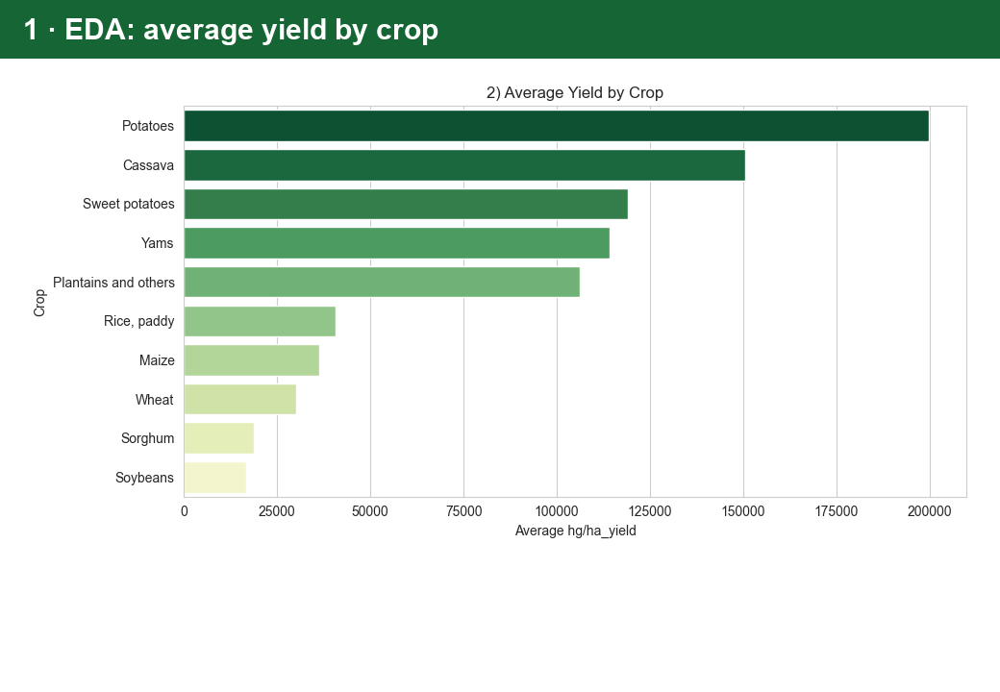
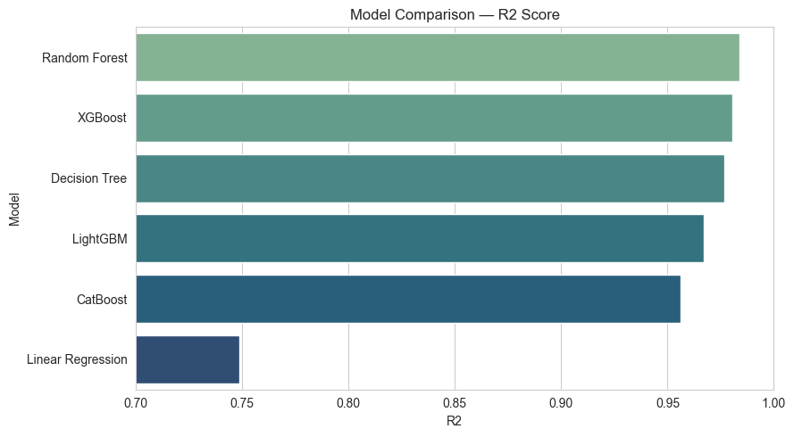
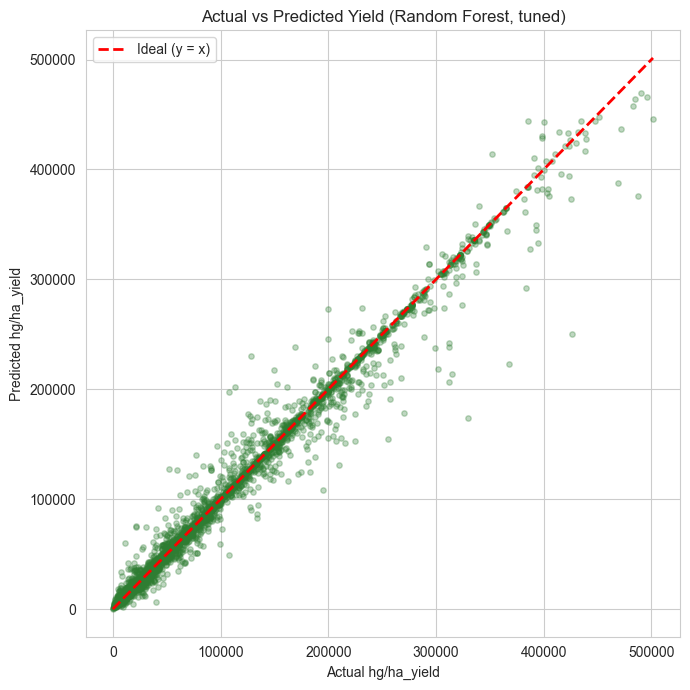
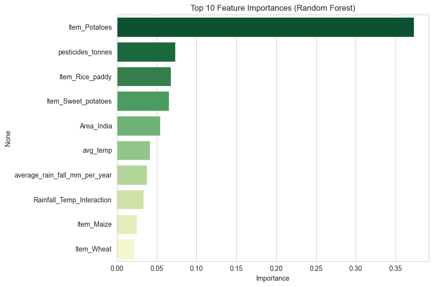
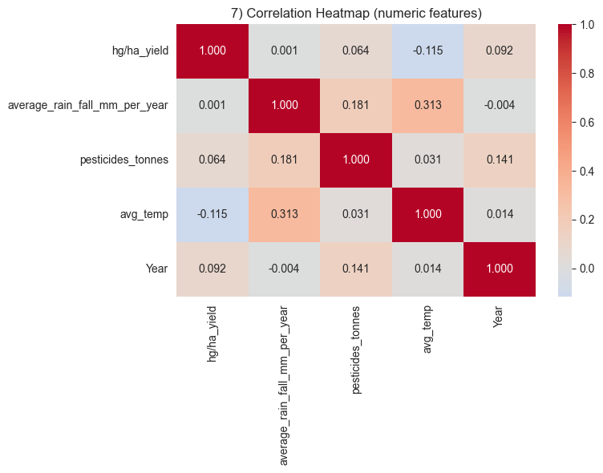

# 🌾 Crop Yield Prediction

**Ekin turi, hudud, yil, yog'ingarchilik va harorat asosida qishloq xo'jaligi hosildorligini
(`hg/ha_yield`) bashorat qiluvchi to'liq Machine Learning pipeline — EDA'dan tortib model
interpretatsiyasigacha.**


[Demo](#-demo) · [Dataset](#dataset) · [Pipeline](#pipeline) · [Key Results](#key-results) · [Usage](#usage) · [Project Structure](#project-structure)

## 🎬 Demo



## Dataset

[Crop Yield Prediction Dataset](https://www.kaggle.com/datasets/patelris/crop-yield-prediction-dataset)
(Kaggle, `patelris/crop-yield-prediction-dataset`) — FAO/World Bank statistikalari asosida, 1990–2013
yillar oralig'ida 101 ta davlat va 10 ta ekin turi bo'yicha 28,242 qator (tozalashdan keyin 25,932).

| Ustun | Tavsif |
|---|---|
| `Area` | Davlat/hudud (101 noyob) |
| `Item` | Ekin turi (10 noyob: Maize, Wheat, Rice, Potatoes, ...) |
| `Year` | Yil (1990–2013) |
| `hg/ha_yield` | **Target** — hosildorlik, hektogramm/gektar |
| `average_rain_fall_mm_per_year` | Yillik o'rtacha yog'ingarchilik |
| `pesticides_tonnes` | Ishlatilgan pestitsid miqdori, tonna |
| `avg_temp` | O'rtacha yillik harorat, °C |

## Pipeline

```
Data Loading → EDA (7 grafik) → Cleaning (duplicate/outlier tahlili)
   → Feature Engineering (4 yangi feature) → One-Hot Encoding
   → Train/Test Split (random + time-based) → Baseline
   → 6 Regression Model (Linear/Tree/Forest/XGB/LightGBM/CatBoost)
   → Cross-Validation (KFold + TimeSeriesSplit) → Hyperparameter Tuning
   → Feature Importance → Actual vs Predicted → Error Analysis
   → Agricultural Business Analysis
```

Barcha bosqichlar bitta notebookda, har bir qadam yozma xulosa/asoslash bilan:
[`notebooks/crop_yield_prediction.ipynb`](notebooks/crop_yield_prediction.ipynb).

## Key Results

| Model | MAE | RMSE | R² |
|---|---|---|---|
| Baseline (mean) | 64,252 | 85,153 | -0.0004 |
| Linear Regression | 29,929 | 42,688 | 0.749 |
| Decision Tree | 4,140 | 12,962 | 0.977 |
| **Random Forest** | **4,130** | **10,793** | **0.984** |
| XGBoost | 6,246 | 11,852 | 0.981 |
| LightGBM | 8,415 | 15,436 | 0.967 |
| CatBoost | 11,033 | 17,864 | 0.956 |

- **Eng yaxshi model:** Random Forest (R² ≈ 0.984 tasodifiy split'da, ≈ 0.95 vaqt bo'yicha split'da).
- **Eng muhim omillar:** ekin turi (ayniqsa Potatoes) va hudud (ayniqsa India) — pestitsid va iqlim
  (harorat/yog'ingarchilik va ularning o'zaro ta'siri) omillaridan ancha ustun.
- **Muhim metodologik topilma:** oddiy K-Fold CV (R² ≈ 0.987) `TimeSeriesSplit`ga (R² ≈ 0.952)
  qaraganda optimistikroq baho beradi — real hayotdagi (kelajakni bashorat qilish) stsenariy
  uchun vaqt bo'yicha validatsiya ancha ishonchli ko'rsatkich.

<table>
<tr><td></td><td></td></tr>
<tr><td align="center">Model comparison (R²)</td><td align="center">Actual vs predicted, tuned Random Forest</td></tr>
<tr><td></td><td></td></tr>
<tr><td align="center">Top feature importances</td><td align="center">Correlation of numeric features</td></tr>
</table>

To'liq tahlil, EDA xulosalari va biznes tavsiyalar notebookning tegishli bo'limlarida.

## Usage

```bash
pip install -r requirements.txt

# Datasetni Kaggle'dan yuklab olish (kaggle API kalitingiz sozlangan bo'lishi kerak)
kaggle datasets download -d patelris/crop-yield-prediction-dataset -p data --unzip

jupyter notebook notebooks/crop_yield_prediction.ipynb
```

## Project Structure

```
data/                              Kaggle dataset (yield_df.csv) — .gitignore orqali repo'ga kirmaydi
notebooks/
  crop_yield_prediction.ipynb      To'liq pipeline: EDA -> modellar -> interpretatsiya
requirements.txt                   Python bog'liqliklari
docs/                              Demo GIF va asosiy grafiklar
```

## Tech stack

Python · pandas · scikit-learn · XGBoost · LightGBM · CatBoost · matplotlib · seaborn · Jupyter

## Author

**Ozodbek Artikbayev** · [GitHub](https://github.com/artikovozodbek)
